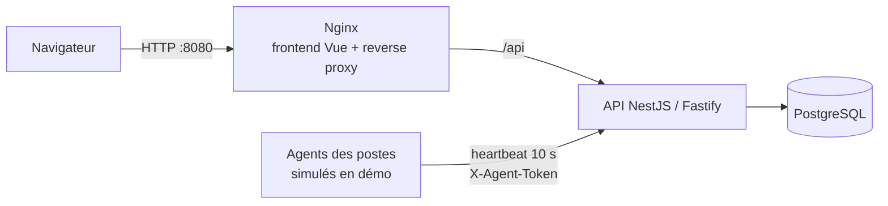

# ParcForm

Application web de **gestion du parc informatique et des salles de formation** pour les écoles de la DHRAT/PFORM.
Elle remplace le fichier Excel utilisé aujourd'hui : on sait à tout moment où se trouve chaque matériel, on enregistre
simplement le matériel arrivant du CND, on administre et supervise les postes des salles, et les formateurs disposent d'un
petit outil de supervision de leur salle.

| Module | Fonctions |
|---|---|
| **Gestion des matériels** | ajout (formulaire ou import CSV), recherche, affectation / déplacement entre salles et postes avec historique, durées d'aptitude, formations induites, export |
| **Administration des postes** | applications métier installées, réinstallation d'un poste, replaquage d'une salle, remontées des utilisateurs |
| **Supervision des postes** | vue temps réel de la salle, processus démarrés, autorisation / interdiction de processus, arrêt d'un processus, alertes, statistiques d'utilisation |
| **Pilotage** | tableau de bord (indicateurs et graphiques), états des lieux PDF, inventaire général |

## Stack technique

| Couche | Technologies |
|---|---|
| Langage | TypeScript partout |
| Front | Vue 3, Vite, Pinia, Vue Router, Chart.js |
| Back | NestJS 11 sur Fastify, validation `class-validator`, JWT, planificateur `@nestjs/schedule` |
| Base de données | PostgreSQL 16, ORM Prisma |
| API | REST documentée en OpenAPI / Swagger (`/api/docs`) |
| Tests | Jest (unitaires + e2e sur vraie base) côté Nest, Vitest + Vue Test Utils côté Vue |
| Infra | Docker (images multi-étapes, utilisateur non root), Nginx (reverse proxy + en-têtes de sécurité), GitHub Actions |



## Démarrage rapide (Docker)

Prérequis : Docker et Docker Compose.

```bash
cp .env.example .env
# Dans .env : choisir POSTGRES_PASSWORD et générer JWT_SECRET :
node -e "console.log(require('crypto').randomBytes(48).toString('base64'))"

docker compose --profile demo up -d --build
```

- Application : <http://localhost:8080>
- Documentation de l'API : <http://localhost:8080/api/docs>

Avec `SEED_DEMO=true`, la base est remplie au premier démarrage (3 salles + magasin, 24 postes, ~90 matériels, 7 jours
d'historique) et le profil `demo` lance l'**agent simulé** qui fait vivre les postes.

| Compte | Rôle | Mot de passe |
|---|---|---|
| `admin@parcform.local` | Administrateur | `ParcForm#2026` |
| `gestionnaire@parcform.local` | Gestionnaire de matériel | `ParcForm#2026` |
| `adminsalle@parcform.local` | Administrateur de salle | `ParcForm#2026` |
| `formateur@parcform.local` | Formateur | `ParcForm#2026` |

> Ces comptes n'existent que si `SEED_DEMO=true`. Changez les mots de passe (menu *Mon compte*) hors démonstration.

## Développement local

Prérequis : Node.js 22, PostgreSQL 16 (ou `docker compose up db`).

```bash
# API
cd backend
cp .env.example .env              # renseigner DATABASE_URL et JWT_SECRET
npm install
npx prisma migrate dev            # crée le schéma
npm run seed                      # données de démonstration
npm run start:dev                 # http://localhost:3000/api/docs

# Interface (autre terminal)
cd frontend
npm install
VITE_COMPTES_DEMO=true npm run dev  # http://localhost:5173 (relaie /api vers :3000)

# Agent simulé (autre terminal)
cd agent
npm install
npm start
```

## Tests

```bash
cd backend && npm test                       # tests unitaires (Jest)
cd backend && npm run test:e2e               # tests de bout en bout — ⚠ base DÉDIÉE, elle est vidée
cd frontend && npm test                      # tests Vitest
```

Les tests e2e couvrent les parcours clés : authentification et droits, ajout / affectation / import de matériel,
heartbeat d'agent avec détection d'un processus interdit et arrêt automatique, replaquage d'une salle suivi jusqu'à la
fin, remontée traitée par l'administrateur de salle, tableau de bord et génération du PDF d'état des lieux.

## Scénario de démonstration (soutenance)

1. **Gestionnaire** — *Matériels* → *Importer un lot* avec `docs/exemple-import.csv` : vérification, puis import.
2. Sélectionner deux UC du magasin → *Déplacer la sélection* vers la salle 201, poste S201-P07. Ouvrir la fiche : l'historique trace le mouvement.
3. Filtre *Aptitude : échue* → les UC de 2020 de la salle 119 ressortent ; *Paramétrage* montre la durée par type.
4. **Formateur** — *Supervision*, salle 119 : les postes vivent en direct. Lorsqu'un stagiaire lance `steam.exe`, le poste passe en rouge, l'alerte remonte et le processus est arrêté automatiquement. Tuer manuellement un `firefox.exe`.
5. *Signaler un problème* sur un poste → **Admin de salle** le traite dans *Remontées*.
6. **Admin de salle** — Salle 105 → *Replaquer la salle* : suivre l'avancement du lot dans *Réinstallations* (≈45 s).
7. *Supervision* → ajouter une règle « interdire `notepad.exe` dans cette salle ».
8. *Documents* → état des lieux PDF de la salle 201 et inventaire général.
9. *Tableau de bord* et *Statistiques* : indicateurs, logiciels les plus utilisés, utilisation des salles.
10. `http://localhost:8080/api/docs` : contrat d'API pour les techniciens.

## Organisation du dépôt

```
backend/     API NestJS (src/<module>/ : controller, service, dto), schéma et seed Prisma, tests
frontend/    Application Vue 3 (views/, components/, stores/, api/), configuration Nginx
agent/       Agent simulé (protocole heartbeat identique à un vrai agent)
docs/        Hypothèses fonctionnelles, backlog Scrum, architecture, sécurité
```

## Documentation projet

- [Hypothèses fonctionnelles et matrice des droits](docs/HYPOTHESES.md) — réponses retenues aux questions posées à la MOA
- [Backlog et organisation Scrum](docs/BACKLOG.md)
- [Architecture et modèle de données](docs/ARCHITECTURE.md)
- [Sécurité](docs/SECURITE.md)
