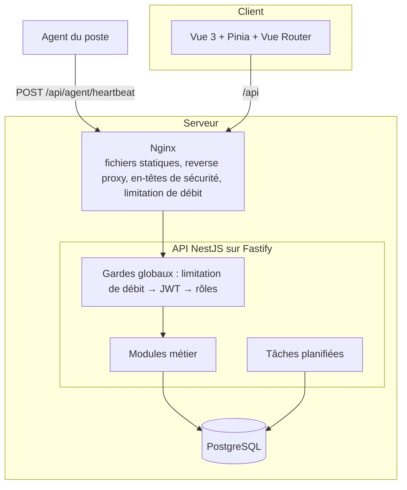
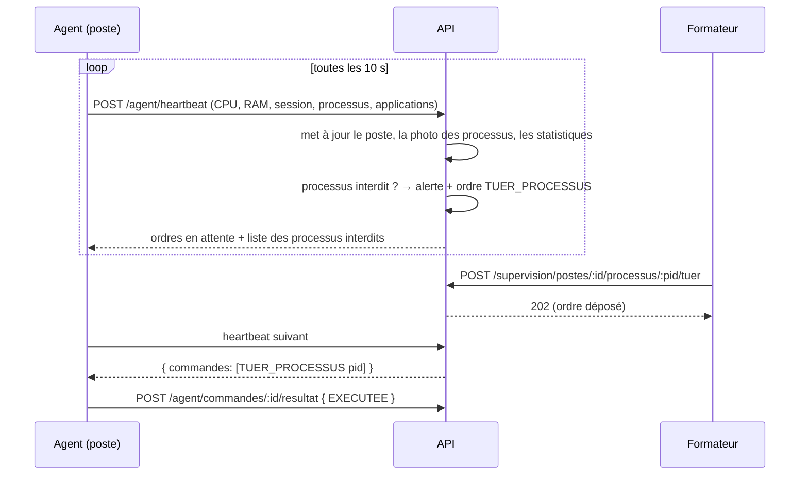
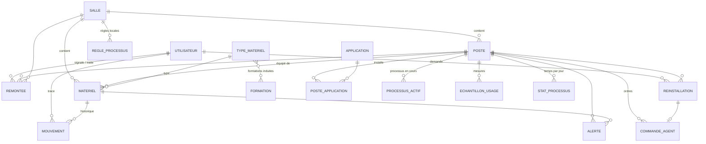

# Architecture

## Vue d'ensemble

Le navigateur et les agents ne parlent qu'à Nginx ; la base n'expose aucun port en dehors du réseau Docker interne.

## Modules de l'API

| Module | Rôle | Routes principales |
|---|---|---|
| `auth` | connexion, profil, changement de mot de passe | `POST /auth/login`, `GET /auth/moi` |
| `utilisateurs` | comptes et rôles (ADMIN) | `/utilisateurs` |
| `salles` | salles, compteurs | `/salles` |
| `materiels` | inventaire, recherche, affectation tracée, import / export CSV | `/materiels`, `/materiels/:id/affectation`, `/materiels/import` |
| `parametrage` | types de matériel (durée d'aptitude), formations induites, catalogue d'applications | `/types-materiel`, `/formations`, `/applications` |
| `postes` | postes, jeton d'agent, applications installées | `/postes` |
| `reinstallations` | réinstallation d'un poste, replaquage d'une salle | `/reinstallations/poste/:id`, `/reinstallations/salle/:id` |
| `remontees` | signalements et traitement | `/remontees` |
| `supervision` | vue temps réel, arrêt de processus, règles | `/supervision/salles/:id`, `/supervision/regles` |
| `agent` | point d'entrée des agents (jeton) | `/agent/heartbeat`, `/agent/commandes/:id/resultat` |
| `alertes` | alertes + tâches planifiées (hors ligne, aptitudes, purge) | `/alertes` |
| `statistiques` | tableau de bord et statistiques | `/tableau-de-bord`, `/statistiques/*` |
| `documents` | PDF d'état des lieux et d'inventaire | `/documents/*` |

Chaque module suit la même structure : `*.controller.ts` (routes, droits, documentation Swagger), `*.service.ts`
(logique métier, accès Prisma), `*.dto.ts` (validation des entrées).

## Protocole agent ↔ API

- L'agent s'authentifie par un **jeton propre au poste** (en-tête `X-Agent-Token`), généré à la déclaration du poste et
  affiché une seule fois ; seule son empreinte SHA‑256 est stockée.
- Le modèle **pull** (l'agent interroge l'API) évite d'ouvrir des ports entrants sur les postes.
- Un poste sans heartbeat depuis 2 minutes est considéré hors ligne (tâche planifiée chaque minute → alerte).
- La réinstallation suit le même circuit : ordre `REINSTALLER`, l'agent répond `EN_COURS` puis `EXECUTEE` / `ECHEC`.

## Modèle de données

Le schéma complet (types, contraintes, index) est dans [`backend/prisma/schema.prisma`](../backend/prisma/schema.prisma).

Choix notables :
- **Prisma « sans moteur Rust »** (`engineType = "client"` + adaptateur `@prisma/adapter-pg`) : les requêtes passent par le
  pilote PostgreSQL `pg`, aucun binaire natif n'est chargé à l'exécution.
- **Fin d'aptitude calculée**, jamais stockée : modifier la durée d'un type met à jour tout le parc.
- **Mouvements avec libellés figés** : l'historique reste lisible même si une salle est renommée ou supprimée.
- **Statistiques agrégées par jour** (`stats_processus`) via un `INSERT … ON CONFLICT` unique par heartbeat ; les
  échantillons bruts sont purgés après 30 jours.

## Frontend

| Dossier | Contenu |
|---|---|
| `api/` | client HTTP (jeton, erreurs, téléchargements) et types du contrat d'API |
| `stores/` | Pinia : session (`auth`), notifications, données de référence (salles, types) |
| `router/` | routes, garde de navigation (connexion + droits) |
| `utils/` | matrice des droits (miroir de l'API), libellés et formats |
| `components/` | mise en page, modale (`<dialog>` natif), formulaires réutilisables, jauges, graphiques |
| `views/` | un écran par route |

Les droits affichés côté interface ne sont qu'une commodité : **l'API reste l'unique autorité** et refuse toute action non
autorisée (403).
